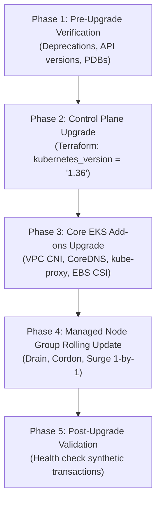

# Marketplace Risk Detection Platform: Infrastructure Architecture & Engineering Specification

## 1. Executive Summary & Platform Context

The **Marketplace Risk Detection Platform** is an enterprise-grade, high-throughput financial and transaction security system. The platform continuously evaluates real-time buyer/seller behavior, detects payment fraud, identifies synthetic identity rings, enforces Anti-Money Laundering (AML) sanctions, and prevents marketplace abuse across millions of transactions daily.

Due to the sensitive nature of financial telemetry and regulatory standards (PCI-DSS Level 1, SOC-2 Type II, ISO/IEC 27001), the infrastructure architecture enforces **strict zero-trust network isolation**, **full encryption in transit and at rest with automated key rotation**, **immutable state locking**, and **zero single points of failure**.

### Core Architecture Tenets
- **Zero Public Ingress for Core Assets**: Neither the Kubernetes API Server nor the PostgreSQL database instances expose public endpoints. All administrative and operational traffic traverses private AWS endpoints or SSM Session Manager.
- **Native Terraform 1.10+ State Locking**: Migration away from legacy DynamoDB locking tables to native S3 conditional write state locking (`use_lockfile = true`), reducing architectural complexity, operational overhead, and distributed lock synchronization drift.
- **Multi-AZ Fault Tolerance**: Infrastructure is distributed across three AWS Availability Zones (AZs) in a designated region, ensuring seamless failover without transaction interruption.
- **Zero-Downtime Continuous Operations**: Compute node groups and database layers employ rolling deployment mechanics and synchronous standby replicas to ensure 99.99% platform availability.

---

## 2. Directory Structure & Module Boundaries

The repository follows a clean separation between **reusable, composable standard modules** and **environment-specific execution roots**. Each environment (`dev`, `staging`, `prod`) maintains an isolated state file, preventing failure blast radiuses from propagating across boundaries.

```
.
├── ARCHITECTURE.md                           # System architecture & operational runbooks
├── environments/
│   ├── dev/                                  # Development environment
│   │   ├── main.tf                           # Module instantiations for dev
│   │   ├── variables.tf                      # Dev input variables & defaults
│   │   ├── outputs.tf                        # Exposed dev endpoints and ARNs
│   │   ├── terraform.tfvars                  # Concrete dev configuration values
│   │   └── versions.tf                       # TF 1.10+ native S3 backend declaration
│   ├── staging/                              # Staging / Pre-production environment
│   │   ├── main.tf                           # Module instantiations for staging
│   │   ├── variables.tf                      # Staging input variables & defaults
│   │   ├── outputs.tf                        # Exposed staging endpoints and ARNs
│   │   ├── terraform.tfvars                  # Concrete staging configuration values
│   │   └── versions.tf                       # TF 1.10+ native S3 backend declaration
│   └── prod/                                 # Production environment
│       ├── main.tf                           # Module instantiations for prod (HA)
│       ├── variables.tf                      # Production input variables & defaults
│       ├── outputs.tf                        # Exposed prod endpoints and ARNs
│       ├── terraform.tfvars                  # Concrete prod configuration values
│       └── versions.tf                       # TF 1.10+ native S3 backend declaration
└── modules/
    ├── s3-backend/                           # S3 state bucket with native conditional locking
    │   ├── main.tf
    │   ├── variables.tf
    │   ├── outputs.tf
    │   └── README.md
    ├── vpc/                                  # 3-AZ VPC, NAT Gateways, SG baseline, Flow Logs
    │   ├── main.tf
    │   ├── variables.tf
    │   ├── outputs.tf
    │   └── README.md
    ├── eks/                                  # Private EKS 1.35, MNG rolling updates, IRSA
    │   ├── main.tf
    │   ├── variables.tf
    │   ├── outputs.tf
    │   └── README.md
    ├── rds/                                  # Multi-AZ Postgres 16, 14d backup, Secrets Manager
    │   ├── main.tf
    │   ├── variables.tf
    │   ├── outputs.tf
    │   └── README.md
    └── iam-secrets/                          # CI/CD credential secret & restricted IAM profile
        ├── main.tf
        ├── variables.tf
        ├── outputs.tf
        └── README.md
```

### Module Boundary Responsibilities

| Module | Primary Responsibility | Critical Interfaces & Data Contracts |
|---|---|---|
| `modules/s3-backend` | Manages remote state bucket with native S3 conditional write locking and envelope KMS key. | Independent bootstrap module. Exports S3 Bucket ID, KMS ARN, and backend config snippet. |
| `modules/vpc` | Provisions 3-tier subnets across 3 AZs, NAT Gateways, S3 Gateway endpoint, locked default SG, and VPC Flow Logs. | Ingests CIDRs and cluster name. Exports `vpc_id`, `private_subnet_ids`, `database_subnet_ids`, and `db_subnet_group_name`. |
| `modules/eks` | Provisions private-only EKS v1.35 cluster, hardened launch template (IMDSv2, KMS gp3), zero-downtime node group, and OIDC provider. | Ingests `vpc_id` and `private_subnet_ids`. Exports `cluster_name`, `cluster_endpoint`, `node_security_group_id`, and `oidc_provider_arn`. |
| `modules/rds` | Provisions private Multi-AZ PostgreSQL instance, parameter group enforcing SSL, 14-day PITR, and native Secrets Manager credentials. | Ingests `db_subnet_group_name` and `eks_node_security_group_id`. Exports connection address, port, and Secrets Manager secret ARNs. |
| `modules/iam-secrets` | Provisions KMS-encrypted Secrets Manager secret for CI/CD and a zero-trust IAM instance profile allowing solely `secretsmanager:GetSecretValue`. | Ingests secret name prefix and environment. Exports `secret_arn` and `iam_instance_profile_arn`. |

---

## 3. High-Availability Networking Topology

The network layout enforces strict micro-segmentation across three Availability Zones. Egress traffic to the internet is mediated by NAT Gateways, while inbound ingress from the public internet is barred from directly addressing compute or database tiers.

```mermaid
flowchart TD
    subgraph Internet ["Public Internet"]
        IGW["AWS Internet Gateway"]
    end

    subgraph VPC ["VPC (10.0.0.0/16) - 3 Availability Zones"]
        subgraph PublicTier ["Public Subnet Tier (10.0.1.0/24, 10.0.2.0/24, 10.0.3.0/24)"]
            NAT1["NAT Gateway AZ-A"]
            NAT2["NAT Gateway AZ-B"]
            NAT3["NAT Gateway AZ-C"]
            ALB["External ALB (Future Ingress)"]
        end

        subgraph PrivateTier ["Private Subnet Tier (10.0.11.0/24, 10.0.12.0/24, 10.0.13.0/24)"]
            subgraph EKS ["EKS Cluster (v1.35) - Private Control Plane"]
                Node1["Node Group AZ-A (Risk Pods)"]
                Node2["Node Group AZ-B (Risk Pods)"]
                Node3["Node Group AZ-C (Risk Pods)"]
            end
        end

        subgraph DatabaseTier ["Database Subnet Tier (10.0.21.0/24, 10.0.22.0/24, 10.0.23.0/24)"]
            subgraph RDS ["Multi-AZ PostgreSQL 16 (Port 5432)"]
                PrimaryDB["Primary DB (AZ-A)"]
                StandbyDB["Sync Standby DB (AZ-B)"]
            end
        end

        subgraph Endpoints ["AWS VPC Endpoints"]
            S3Endpoint["S3 Gateway Endpoint"]
        end
    end

    IGW --> PublicTier
    NAT1 --> IGW
    NAT2 --> IGW
    NAT3 --> IGW
    Node1 --> NAT1
    Node2 --> NAT2
    Node3 --> NAT3
    Node1 & Node2 & Node3 -.-> S3Endpoint
    Node1 & Node2 & Node3 -->|Port 5432 Only (TLS 1.3)| PrimaryDB
    PrimaryDB -.->|Synchronous Physical Replication| StandbyDB
```

### Subnet Allocation & CIDR Strategy

| Tier | AZ 1 CIDR | AZ 2 CIDR | AZ 3 CIDR | Route Table Destination | Purpose |
|---|---|---|---|---|---|
| **Public** | `10.0.1.0/24` | `10.0.2.0/24` | `10.0.3.0/24` | `0.0.0.0/0 -> IGW` | Houses NAT Gateways and external ingress ALBs. Tagged `kubernetes.io/role/elb = 1`. |
| **Private** | `10.0.11.0/24` | `10.0.12.0/24` | `10.0.13.0/24` | `0.0.0.0/0 -> NAT GW (AZ)` | Houses EKS worker nodes, risk scoring microservices, and internal load balancers. Tagged `kubernetes.io/role/internal-elb = 1`. |
| **Database** | `10.0.21.0/24` | `10.0.22.0/24` | `10.0.23.0/24` | Local VPC Only (No Internet route) | Houses Multi-AZ PostgreSQL database instances. Strictly isolated. |

### NAT Gateway Resiliency Model
- **Production (`prod`)**: Deploys **three independent NAT Gateways** (one per AZ). If an AWS data center or AZ suffers a major fiber cut or power loss, workloads in the remaining two AZs maintain undisturbed outbound connectivity.
- **Non-Production (`dev`)**: Uses `single_nat_gateway = true`, routing all private subnets through a single NAT Gateway located in AZ 1. This retains identical routing behavior while saving ~$65/month per eliminated NAT Gateway.

### Security Baselines & Defense-in-Depth
1. **Default Security Group Neutralization (CIS Benchmark 5.4)**: The VPC default security group (`aws_default_security_group.default`) has all inbound and outbound rules purged, ensuring that any unassigned resource is completely quarantined by default.
2. **Dedicated Database Ingress Security**: Port `5432` on RDS is accessible **exclusively** from the EKS Node Security Group (`aws_security_group.node.id`). No other VPC CIDR, public IP, or peered VPC can open a socket to the database.
3. **Gateway VPC Endpoints**: An S3 Gateway Endpoint is automatically injected into all private and database route tables. Container image layers from Amazon ECR and state storage from Amazon S3 are transferred entirely across the high-speed AWS internal network, avoiding NAT Gateway data processing surcharges ($0.045/GB) and egress latency.
4. **VPC Flow Logs**: High-frequency IP telemetry is streamed to CloudWatch Logs with a 90-day retention window for auditing and automated threat detection (e.g., GuardDuty).

---

## 4. S3 Native Backend & Terraform 1.10+ State Locking

Historically, Terraform S3 state backends required an Amazon DynamoDB table with a `LockID` primary partition key to manage distributed state locking. Terraform 1.10 introduced **native S3 state locking** utilizing S3 conditional writes.

### How Native S3 State Locking Works
- **S3 Conditional Writes**: In Terraform 1.10+, setting `use_lockfile = true` causes Terraform to write a `.tflock` object alongside the `.tfstate` key in S3.
- **Concurrency Control**: Terraform utilizes S3's `PutObject` operation with an `If-None-Match: *` conditional header. If another concurrent execution (`terraform apply` or `terraform plan`) is already writing or holds the lockfile, Amazon S3 rejects the operation with an `HTTP 412 Precondition Failed` error.
- **Architectural Advantages**:
  - **Zero DynamoDB Dependency**: Eliminates the operational overhead of provisioning, managing, and paying for DynamoDB write capacity units (WCU) or on-demand tables.
  - **No State Lock Desynchronization**: Eliminates rare split-brain scenarios where DynamoDB records a lock that S3 has already completed or vice-versa.
  - **Native Multi-AZ Durability**: Leverages S3's 99.999999999% (11 9s) durability across 3 Availability Zones natively.

### Enterprise S3 Bucket Hardening
The `modules/s3-backend` module establishes the following guardrails:
1. **S3 Versioning Enabled**: Every revision of the state file is immutably archived. Accidental state corruption or malicious overwriting can be rolled back to any previous timestamp.
2. **SSE-KMS Encryption**: State files are encrypted using a dedicated Customer Managed Key (CMK) with automated 30-day rotation. S3 Bucket Keys are enabled to reduce KMS request costs by ~99%.
3. **Public Access Block**: All four flags (`block_public_acls`, `block_public_policy`, `ignore_public_acls`, `restrict_public_buckets`) are enforced to prevent data exposure.
4. **Enforced TLS 1.2+ Transport**: Bucket policies reject any incoming HTTP requests where `aws:SecureTransport == false` or `s3:TlsVersion < 1.2`.
5. **Lifecycle Retention**: State revisions older than 90 days are expired automatically to prevent unbounded storage inflation while preserving necessary compliance auditing.

---

## 5. Kubernetes Tier: Private EKS 1.35 & Node Rollout Architecture

The compute foundation runs on **Amazon EKS version 1.35** inside the private subnet tier.

### Control Plane Isolation
```hcl
vpc_config {
  subnet_ids              = var.private_subnet_ids
  endpoint_private_access = true
  endpoint_public_access  = false # No public internet exposure
}
```
With `endpoint_public_access = false`, the Kubernetes API server has no public DNS record or public IP. Administrative access is restricted to:
- Systems Manager (SSM) Session Manager through a private bastion host.
- AWS Client VPN / Direct Connect terminated inside the VPC.
- In-cluster CI/CD runners operating within the private subnets.

### Envelope Encryption with Customer Managed KMS
Kubernetes Secrets (API keys, JWT signing keys, risk model weights) are encrypted at rest inside `etcd` using an AWS KMS Customer Managed Key via the Kubernetes envelope encryption provider:
```hcl
encryption_config {
  provider {
    key_arn = aws_kms_key.cluster.arn
  }
  resources = ["secrets"]
}
```

### Zero-Downtime Managed Node Group Rolling Updates
Zero-downtime rolling upgrades for worker nodes are achieved through four interlocking mechanisms:

1. **`update_config` with `max_unavailable = 1`**:
   During an AMI update or instance replacement, EKS ensures that at most one node is taken offline at a time.
2. **Pod Disruption Budgets (PDB)**:
   Platform workloads (e.g., Risk Detection Engine microservices) declare PDBs requiring `minAvailable: 2` or `maxUnavailable: 1`. When EKS issues a `kubectl drain`, the API server respects the PDB, blocking node eviction until replica pods have passed readiness probes on replacement nodes.
3. **Immutable Launch Templates (`create_before_destroy = true`)**:
   Updates to launch template configurations (instance types, security groups, disk configurations) create a new version without destroying running nodes prematurely.
4. **Hardened Node Launch Specifications**:
   - **Enforced IMDSv2**: `http_tokens = "required"` and `http_put_response_hop_limit = 1`. This stops server-side request forgery (SSRF) attacks from extracting node instance profile IAM credentials from within containerized pods.
   - **KMS Encrypted gp3 Root Volumes**: All node ephemeral storage is encrypted with an automated rotating KMS CMK.

### IAM Roles for Service Accounts (IRSA)
Static AWS access keys are barred from the platform. Pods obtain fine-grained AWS credentials dynamically via OIDC token exchange:
- Cluster establishes an `aws_iam_openid_connect_provider`.
- Microservice pods specify a Kubernetes `ServiceAccount` annotated with the IAM Role ARN.
- The AWS STS service verifies the OIDC JWT token issued by Kubernetes and exchanges it for temporary STS credentials restricted strictly to the service's role (e.g., reading risk models from S3 or querying audit logs).

---

## 6. Database Tier: Multi-AZ PostgreSQL 16 & Secrets Management

The data persistence layer runs on **Amazon RDS PostgreSQL 16** configured for mission-critical risk transaction logs, seller fraud graphs, and ledger history.

### High Availability & Multi-AZ Failover
- **Synchronous Replication**: The primary database in AZ 1 synchronously replicates storage blocks to a hot standby in AZ 2.
- **Failover SLA**: If the primary database suffers hardware failure, network partitioning, or AZ outage, RDS triggers an automated failover. The DNS endpoint (`aws_db_instance.main.endpoint`) is dynamically repointed to the standby instance within **60 to 120 seconds**, with zero data loss (RPO = 0).

### Storage Autoscaling Architecture
The database storage is provisioned with `allocated_storage = 50` GiB (`gp3`) and `max_allocated_storage = 500` GiB.
- Storage autoscaling automatically expands capacity when free storage falls below 10% for more than 5 minutes.
- Prevents database downtime and transaction rejection during high-volume fraud spikes or holiday marketplace traffic surges.

### 14-Day Backup Retention & Compliance
- `backup_retention_period = 14`: Daily automated physical snapshots are retained for 14 days, providing continuous transaction log (WAL) archiving for Point-In-Time Recovery (PITR) to any second within the two-week window.
- `copy_tags_to_snapshot = true`: Preserves ownership, environment, and compliance tracking metadata on all automated backups.

### Native Secrets Manager Integration
Master database administrator passwords are never defined in code or stored in plaintext state:
```hcl
manage_master_user_password   = true
master_user_secret_kms_key_id = aws_kms_key.rds.arn
```
AWS RDS natively provisions an encrypted secret in AWS Secrets Manager under the hood, continuously managing and rotating the master credentials. Applications consume connection metadata via a structured secret output.

---

## 7. CI/CD Credentials & Zero-Trust IAM Architecture

The `modules/iam-secrets` module enforces the **Principle of Least Privilege** for build and deployment runners.

### Strict Scoped IAM Policy
The CI/CD runner IAM Role has no broad permissions. It is explicitly limited to retrieving only the specific deployment secret ARN:
```json
{
  "Version": "2012-10-17",
  "Statement": [
    {
      "Sid": "StrictGetSecretValueOnly",
      "Effect": "Allow",
      "Action": [
        "secretsmanager:GetSecretValue",
        "secretsmanager:DescribeSecret"
      ],
      "Resource": "arn:aws:secretsmanager:us-east-1:123456789012:secret:prod/cicd/deployment-credentials-XXXXXX"
    },
    {
      "Sid": "KmsDecryptOnly",
      "Effect": "Allow",
      "Action": [
        "kms:Decrypt",
        "kms:DescribeKey"
      ],
      "Resource": "arn:aws:kms:us-east-1:123456789012:key/your-secrets-key-id"
    }
  ]
}
```
Any attempt by a compromised CI/CD runner to list other secrets, modify policies, create resources, or read database credentials is systematically rejected by the AWS IAM evaluation engine.

---

## 8. Operational Runbooks & Upgrade Strategies

### 8.1. EKS Cluster Upgrade Strategy (e.g., v1.35 -> v1.36)

EKS upgrades must follow a strict sequential procedure to preserve 100% platform availability:



#### Step 1: Pre-Upgrade API Version Check
Execute Pluto or `kubectl krew deprecations` to scan existing Helm charts and manifests for deprecated Kubernetes APIs:
```bash
pluto detect-helm -o wide
pluto detect-files -d ./k8s-manifests
```
Verify that all platform Pod Disruption Budgets (PDBs) have `allowedDisruptions >= 1`:
```bash
kubectl get pdb -A
```

#### Step 2: Control Plane Upgrade
1. In the target environment (`environments/prod/variables.tf` or `terraform.tfvars`), update:
   ```hcl
   kubernetes_version = "1.36"
   ```
2. Execute plan and apply:
   ```bash
   terraform plan -out=tfplan
   terraform apply tfplan
   ```
   *AWS upgrades the control plane instances across AZs in a blue/green fashion. The Kubernetes API server remains reachable throughout the process.*

#### Step 3: Upgrade In-Cluster Add-ons
Immediately update core add-ons to match Kubernetes 1.36 specifications:
- `vpc-cni`
- `kube-proxy`
- `coredns`
- `aws-ebs-csi-driver`

#### Step 4: Managed Node Group Rolling Update
When the EKS module detects an updated Kubernetes version or updated Launch Template AMI, AWS EKS Managed Node Groups orchestrate an automated rolling update:
1. EKS provisions a replacement EC2 instance using the new AMI/version.
2. The old node is **cordoned** (`SchedulingDisabled`).
3. EKS issues a `kubectl drain` with a 15-minute grace period. Pods migrate to healthy nodes that satisfy PDB constraints.
4. Once drained, the old node is terminated.
5. The cycle repeats until all nodes in the node group are replaced.

---

### 8.2. RDS PostgreSQL Upgrade Strategy

#### Minor Version Upgrades (e.g., 16.4 -> 16.5)
- Automated minor version upgrades are enabled (`auto_minor_version_upgrade = true`).
- AWS applies minor security patches during the configured weekly maintenance window (`Sun:04:30-Sun:05:30 UTC`).
- For Multi-AZ instances, RDS upgrades the standby host first, fails over to the standby, and then upgrades the former primary, keeping downtime under **120 seconds**.

#### Major Version Upgrades (e.g., PostgreSQL 16 -> PostgreSQL 17)
For zero-downtime or near-zero-downtime major version migrations in production:
1. **AWS RDS Blue/Green Deployment (Recommended)**:
   - Create an RDS Blue/Green Deployment via AWS Console or CLI:
     ```bash
     aws rds create-blue-green-deployment \
       --blue-green-deployment-name risk-db-pg17-upgrade \
       --source arn:aws:rds:us-east-1:123456789012:db:prod-risk-detection-db \
       --target-engine-version 17.0
     ```
   - RDS creates a fully synchronized "Green" copy running PostgreSQL 17 with replication active.
   - Run integration and performance regression tests against the Green database.
   - Switch over traffic:
     ```bash
     aws rds switchover-blue-green-deployment \
       --blue-green-deployment-id bgd-xxxxxx \
       --switchover-timeout 300
     ```
   - Traffic cutover typically takes **under 30 seconds** with zero data loss.
2. **Terraform Reconciliation**:
   Once the green environment is promoted, update `engine_version = "17.0"` in `environments/prod/terraform.tfvars` and run `terraform refresh` to synchronize the state file.

---

### 8.3. Node Group Rollback & Troubleshooting Runbook

If a rolling node update stalls due to a Pod Disruption Budget deadlock or application startup failure:
1. **Identify Stalled Node**:
   ```bash
   kubectl get nodes -o wide
   kubectl describe node <stalled-node-name>
   ```
2. **Check Eviction Blockers**:
   ```bash
   kubectl get events -A --sort-by='.metadata.creationTimestamp' | grep -i "FailedDrain"
   ```
3. **Emergency PDB Override**:
   If an misconfigured workload prevents node draining during a critical operational window, temporarily patch the PDB:
   ```bash
   kubectl scale deployment <stalled-app> --replicas=4 -n <namespace>
   ```
4. **Terraform Rollback**:
   Revert the launch template or AMI variable to the previous git commit in `environments/prod/` and re-apply Terraform. EKS will roll instances back to the verified launch template.

---

### 8.4. Disaster Recovery & Business Continuity Metrics

| Metric | Target | Architecture Provision |
|---|---|---|
| **Recovery Point Objective (RPO)** | **0 seconds** | Synchronous Multi-AZ storage replication for RDS; 14-day continuous WAL point-in-time recovery; S3 Versioning on all state & artifacts. |
| **Recovery Time Objective (RTO)** | **< 2 minutes** | Automatic RDS failover within 60-120 seconds; multi-node EKS cluster with automatic pod rescheduling and node health checks. |
| **Regional Outage DR** | **< 30 minutes** | Infrastructure as Code (IaC) modularity allows rapid spin-up in an alternate AWS region (`us-west-2` or `eu-west-1`) using cross-region S3 state replication and RDS cross-region read replicas. |
